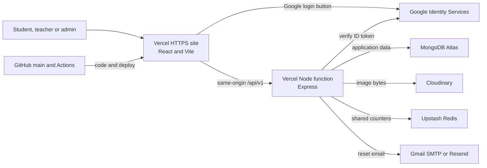
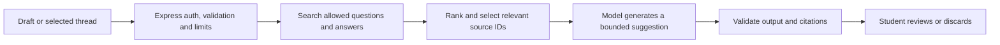

<!-- consistency-review-2026-11-13 -->
> Current status, 13 November 2026 — See [current implementation and limits](CURRENT_STATE.md). The active design has Auto/Light/Dark themes and a separate community resource Library. Institution-scoped curriculum and publication review remain planned. Older counts, release IDs and provider checks below are dated evidence, not current certification.

# Student Doubt Forum | A–Z playbook

> **Status update 13 November 2026.** This document describes the build at code reference `827e8df` and has not been rewritten line by line. Changes since then are listed in [PROJECT_CONTEXT.md](../PROJECT_CONTEXT.md) (section "Update 13 November 2026"), the [API notes](API.md) and the [Design v3 change record](DESIGN_V3_CHANGE_RECORD.md). Where they differ, the newer records win. Features added since: resource Library, Trending Topics, Top Contributors, view counts, Light and Dark themes, header search that keeps filters, Python and C and C++ subjects.

**Last reviewed:** 10 November 2026  
**Code reference:** `827e8df` on `main`  
**Audience:** project owner, students, teachers, demo reviewers, testers and future maintainers  
**Language:** Hinglish explanations, with actual UI labels and commands in English

- [Live Doubt Forum](https://student-doubt-forum-theta.vercel.app/)
- [Live sign-in](https://student-doubt-forum-theta.vercel.app/login)
- [Source repository](https://github.com/Raju-ol/student-doubt-forum)
- [Study Library](https://student-doubt-forum-theta.vercel.app/?scope=all&tag=study-library)
- [Verified CI run for the referenced code](https://github.com/Raju-ol/student-doubt-forum/actions/runs/42812978312)

Use this file as the current guide. Dated change records describe earlier milestones, including the period before Google login and Gmail recovery. This playbook contains no live credentials. Commands with angle-bracket placeholders need your own values.

## Where to start

| Aapko kya chahiye | Section |
| --- | --- |
| Project samajhna aur present karna | [A. Project overview](#a-project-overview) |
| Login, post, answer, vote, comment, accept | [B. Student walkthrough](#b-student-walkthrough) |
| Profile, notifications, password reset and privacy | [C. Account and notifications](#c-account-and-notifications) |
| Viva, submission and demo script | [D. College demo and submission](#d-college-demo-and-submission) |
| Tech stack, files, APIs and database | [E. How the system works](#e-how-the-system-works) |
| Local installation | [F. Run locally](#f-run-locally) |
| Vercel, Atlas, Cloudinary, Upstash, Google and Gmail | [G. Deploy and configure](#g-deploy-and-configure) |
| Updates, backups and staging | [H. Operate the site](#h-operate-the-site) |
| Fix an error or verify a change | [I. Troubleshooting and QA](#i-troubleshooting-and-qa) |
| Project history and actual problems | [J. Build history](#j-build-history) |
| Next versions and feature ideas | [K. Future versions](#k-future-versions) |
| AI integration from idea to implementation | [L. AI roadmap](#l-ai-roadmap) |
| Final next steps and admin promotion | [M. Finish and hand over](#m-finish-and-hand-over), [N. Admin and role handover](#n-admin-and-role-handover) |

## A. Project overview

College doubts often get buried in group chats. Doubt Forum keeps a question, its screenshot, answers and follow-up comments together. A student can search the question later, see the author's accepted answer and add another explanation. Teachers can take part and display a Teacher badge. Admins handle reports and organize subject and college catalogues.

**Current state.** The deployed app is suitable for a college demo and limited beta. The owner reported Google sign-in and Gmail password recovery working, including recovery after wider activation. The live Study Library has **200 sample questions across 10 subjects**, each published with an AI-generated study answer. The latest full local suite recorded **90 passing tests**. A targeted 38-test run and GitHub CI passed for the final performance follow-up. Production checks confirmed database access, the combined catalogue, the library count and a sample answer. Full manual cross-role and failure-mode testing remains open.

| Area | What is available now |
| --- | --- |
| Access | Email/password signup and sign-in, Google signup/sign-in, explicit Google linking to an existing account, password reset for password accounts |
| Discovery | Public Explore feed, search by words and English stems, subject/tag/academic level/status filters, college and worldwide scopes |
| Study Library | 200 tagged sample questions and labeled AI-generated explanations, imported as a fixed batch by an admin |
| Questions | Create, edit and delete your own doubt, Markdown preview, code, maths and screenshot attachments |
| Discussion | Answers, follow-up comments on answers, up/down votes, one accepted answer, reputation |
| Account | Public profile, My questions, optional college/level, private notifications, export, account deletion, sign out everywhere |
| Moderation | Report questions/answers, review reports, remove content, suspend/restore students or teachers, assign teacher role, add catalogue entries |
| Interface | Responsive layout, mobile menu, System/Light/Dark theme, keyboard-accessible tabs, loading/error/empty states |
| Optional configuration | Email verification before posting has code support and its own flag. Current rollout focused on password recovery. |
| Future | On-demand AI features, native mobile app, private college spaces, durable jobs, complete staging and a practiced backup restore |

**One-line viva explanation.** “Doubt Forum is a deployed college Q&A app where students can post screenshot-based doubts, get and discuss answers, and preserve useful solutions in a searchable forum.”

## B. Student walkthrough

### 1. Explore and create an account

1. Open the production website and choose **Explore**. A guest can read public questions and profiles.
2. Choose **Sign in → Create an account**. Enter full name, email and a forum password. Academic level and college are optional. Password validation is at least 8 characters and at most 72 UTF-8 bytes.
3. Alternatively, select **Continue with Google** on the login or signup page. A first-time Google user gets a student profile. A returning Google user uses the same Google identity to open that profile.
4. If a password profile already exists with the same email, sign in to that profile first. Open **Account → Google sign-in**, enter the forum password and pick the matching Google account. This links to the existing profile ID, so its posts and reputation stay together.
5. Use the stable production URL for Google login. Vercel's unique deployment URL has a different origin. Google checks the exact origin registered in its OAuth client.

### 2. Find a doubt before posting

- Type a useful term such as `primary key`, `binary search` or `normalization` in Explore. Search ranks matches in titles, tags and bodies. Try complete words when a partial word returns nothing.
- Narrow by subject, tag, academic system or level, and **No accepted answer** or **Accepted answer**. Clear the filters when searching more broadly.
- **My college** is available to a signed-in user with a college selected. **Selected subject worldwide** requires a subject. **Everything** gives the broad feed.
- A college scope is a discovery filter. Questions and direct links are public. College selection is a profile attribute, and teacher badges reflect a role assigned by a forum admin.
- Click a result title. The detail page shows the question, author, images, answers and comments. Search/filter state can be shared by copying the current Explore URL.

### 3. Post a question with a screenshot

1. Sign in and choose **+ Ask a doubt**.
2. Write a specific title. Example: `Why can a primary key never contain NULL in DBMS?` Title is 10–160 characters and description is 20–12,000.
3. Describe the problem, what you tried, and where you are stuck. Choose the subject and optionally an academic level. Add up to five tags such as `dbms`, `keys` and `sql`.
4. Read the college scope note on the form. If your profile has a college, the new post appears in that college's feed and the public worldwide feed. Without a selected college, it appears in the public feed. Editing your profile later does not move the old question.
5. Use **Write** and **Preview** to check formatting. Supported examples include **bold**, inline code like `SELECT`, fenced code blocks with a language, lists, links, quotes and maths such as `$x^2$`. Raw HTML displays as text. Upload images through the attachment picker.
6. Choose **+ Add an image**. Attach up to **3** JPG, PNG or WebP images, **3 MB per image**. Wait for upload to finish and remove any incorrect image before posting. Crop names, roll numbers, credentials and other private information out of screenshots.
7. Select **Post your doubt**. Open the saved question and refresh once. Verify the title, description and attachment, then copy its URL to share.

Good body for a DBMS demo:

```text
I understand that a primary key identifies each row. My table has a
student_id column and an optional phone number. Why can student_id
never be NULL, and why might a UNIQUE constraint behave differently?
```

**Edit or delete.** Open your question and use **Edit → Save changes**. The current edit flow keeps the saved attachments and college association. The editor can warn about unsaved changes when you leave. Use **Delete** only on a question you intend to remove. Question removal also cleans up its answers, comments, votes and linked images. Try destructive actions on disposable demo content or staging.

### 4. Reply, comment, vote and accept

| Action | What to do | What to expect |
| --- | --- | --- |
| Write a full reply | Open a question, write 10–12,000 characters in the answer editor, preview and select **Post your answer**. | Answer appears on the thread. The question author gets an in-app notification when another user answers. |
| Follow up | Find the relevant answer and submit a comment of 2–1,000 characters below it. | The comment stays with that answer. Its author can receive a notification. |
| Improve your reply | Use the answer's **Edit** action and save. | The same answer is updated. |
| Remove your reply | Use **Delete** on your own answer and confirm. | Comments/votes associated with the answer are cleaned up. If it was accepted, the question becomes open. |
| Vote | Use the up or down arrow on someone else's question or answer. Click the same vote to remove it, or the opposite arrow to switch. | One vote per account per target. Self-votes are blocked. |
| Mark solved | The original question author selects **Accept answer**. | One answer is accepted, shown first and marked with a badge. **Remove acceptance** reopens the question. Accepting a different answer changes the selected answer. |
| Report | Select **Report** on a question or answer, give a concise reason and submit. | Moderators can review it. A report alone does not remove content. |

**Reputation.** An answer upvote contributes +10, an answer downvote −2 and acceptance +15 to the answer author. Removing or switching a vote adjusts the previous credit. Question votes affect the question's displayed score. The accepted badge reflects the question author's choice, which can differ from the highest-voted reply.

### 5. Practise with the Study Library

Open the [Study Library feed](https://student-doubt-forum-theta.vercel.app/?scope=all&tag=study-library) or select the `study-library` tag on a sample question. There are 20 questions each in Data Structures, DBMS, Java, Operating Systems, Computer Networks, Mathematics, Web Development, Physics, Statistics and Electrical Engineering.

Filter to a subject, open a question, try it yourself, then compare your reasoning with the AI explanation. The two labeled demo author profiles identify the imported content. The explanations were generated in advance by a separate AI agent and saved as ordinary forum answers. Verify important details with your course material. The live site does not call an AI service when someone opens a question or posts a new one.

## C. Account and notifications

- **Notifications** lists new answers to your questions, comments on your answers and accepted answers. Open the linked thread. Use **Mark as read** for one item or **Mark all as read**. The count refreshes periodically and after relevant navigation or read actions. A short delay is normal. Self-actions do not send you a notification. This is an in-app inbox.
- **My questions** and your profile show recent contributions. Use **Edit profile** for display name, college and academic level. Level can be semester, year, grade, a custom label or omitted. Public profiles expose contribution information, while the account screen shows your email.
- **Forgot password** works for a registered forum password account. Enter its email, open the newest reset link, choose a new forum password and sign in again. The link expires after 30 minutes and is single-use. The password change revokes old forum sessions. The confirmation is deliberately generic for every address. A Google-only user should use **Continue with Google** and Google's own account recovery if needed.
- **Sign out** clears the current tab's session. **Sign out everywhere** on your profile revokes earlier forum sessions across devices. Refresh or sign back in when you need a fresh session.
- **Account → Export my data** downloads NDJSON, with one JSON record per line for your account and related data. Keep the export private.
- **Account → Delete account** requires typing `DELETE`, reauthenticating with the current forum password or linked Google account, and confirming. The app removes account identity and uploaded images and keeps discussions attributed to **Deleted user**. Remove personal details from post text separately if needed. Admin accounts need a controlled ownership handover first.
- **Theme** cycles **System → Light → Dark → System** and remembers your choice in the browser. On mobile, open **Menu** for navigation. Escape closes it and returns focus to the trigger. Profile and moderation tabs support arrow navigation.

## D. College demo and submission

### Before the demo

- Verify Atlas Network Access status and the temporary Vercel entry's actual expiry. Check the production feed and deep links on the same day.
- Two reusable live student QA accounts were created and their logins verified. Use Account A in a normal window and B in Incognito. Their credentials were shared privately with the owner and are outside this playbook. The accounts use `example.test` addresses with no inbox, so use a separate inbox-backed password account for recovery. Prepare an approved moderator account for the admin part if needed.
- Use a safe sample image and a disposable question with a `Demo:` prefix. Bring a local build or a short recording if the venue network is unreliable.
- Save the live URL, source link, sample screenshots, this playbook and a short architecture explanation in the submission.

### Five-minute walkthrough

1. **Problem and solution** (30 s). Show Explore and explain how searchable threads solve lost chat doubts.
2. **Ask** (60 s). Account A signs in, posts the DBMS example with Markdown and an attachment, then refreshes.
3. **Answer and discuss** (60 s). Account B opens the link, posts an answer and optionally votes or comments. Example answer: “A primary key is the chosen unique identifier and must identify every row, so it cannot be NULL. A UNIQUE constraint's treatment of NULL depends on the database.”
4. **Notify and accept** (60 s). Account A opens Notifications, follows the link, marks the notification read and accepts the answer. Refresh and verify the badge. Account B can check its own acceptance notification and profile.
5. **Moderate and explain deployment** (60 s). Show the admin's moderation view with a sample report. Explain Vercel, Atlas, Cloudinary and Upstash using the architecture below.
6. **Close** (30 s). Show the status/subject filters and explain a planned feature such as similar-question search. Describe future features as proposals.

### Viva questions you should be able to answer

| Question | Short answer |
| --- | --- |
| Why MongoDB? | Questions, answers, votes and users have separate collections and references. It fits a JavaScript app with optional fields such as academic level and attachments. |
| What makes an answer accepted? | A server permission check requires the original question author. The question stores the chosen answer ID. |
| Where are image bytes stored? | Cloudinary. MongoDB stores the reference, public ID and ownership metadata. |
| How does Google login prove identity? | The server verifies Google's signed ID token and binds its stable subject to the forum profile. It issues the forum's own session token. |
| How is a reset link protected? | The database stores a hash of the random token, with a short expiry. The reset operation consumes it once and revokes earlier sessions. |
| How do you stop request abuse? | Shared Upstash counters enforce limits across Vercel instances, using pseudonymous keys. Limits cover login, recovery, uploads and content writes. |
| What breaks if Atlas is unavailable? | The static frontend can still load. Data/API requests can return a database-unavailable response. |
| What is the main remaining engineering work? | Prove backup restore, separate staging, and make multi-step writes recoverable under failure and concurrency. |

## E. How the system works



**Post ka lifecycle.** React uploads the screenshot first. Express validates the MIME type, file signature and size, then saves the Cloudinary image reference with its uploader. When you post the question, the API checks the token, validates the question and confirms you own each unattached image. MongoDB records the question and associates the image references. Opening the question later fetches discussion data from MongoDB and loads image bytes from Cloudinary.

**Login ka lifecycle.** Password signup stores a bcrypt hash with cost 12. Password login compares the hash. For Google, the backend verifies the ID token's signature, audience and validity with Google's library, then resolves the linked Google subject. Both routes issue the app's HS256 bearer token, which lasts seven days. The browser uses tab session storage. On protected calls the API checks account status and token version against MongoDB.

**Answer ka lifecycle.** A reply creates an Answer linked to a Doubt. The backend also attempts to save an in-app notification for the original author. Answers and comments are loaded together for a thread. Accepted answers sort first, then by score. Votes and acceptances update stored reputation. Historical profiles can initialize the score from votes and acceptance records.

### Technology and why we picked it

| Piece | Role in this project |
| --- | --- |
| React and React Router | Reusable pages and components, browser navigation, forms, account state, responsive UI |
| Vite | Local dev server and compiled production bundle |
| Node.js and Express | A small JavaScript API for validation, authorization, forum writes, moderation and integrations |
| MongoDB Atlas and Mongoose | Hosted data, schema validation, references, indexes and weighted text search |
| Cloudinary and Multer | Image delivery plus server-side multipart intake and checks |
| Upstash Redis | A shared rate-limit store across warm and cold function instances |
| Google Identity Services | A familiar sign-in button and verifiable identity |
| Nodemailer + Gmail SMTP | Domain-free beta recovery for accounts with forum passwords |
| Resend | Earlier owner-only email test and an available alternative for a verified sender |
| Marked, KaTeX, highlight.js, DOMPurify | Markdown conversion, equations, highlighted code and sanitized rendered HTML |
| GitHub, Actions and Vercel | Source history, automated checks and deployment |

**Why Vercel?** We wanted one HTTPS URL for the React pages and Express API, automatic deploys from GitHub, and a dashboard for logs, environment settings and deployments. Vercel serves the compiled Vite bundle and forwards API requests to the existing Node entry point. The earlier Render blueprint is still in the repository as an alternative. Vercel is useful for this demo architecture. If background jobs, fixed outbound IPs or higher traffic become important, compare hosting and networking costs before deciding. [Vite on Vercel](https://vercel.com/docs/frameworks/frontend/vite), [Express on Vercel](https://vercel.com/docs/frameworks/backend/express), [GitHub deployments](https://vercel.com/docs/git/vercel-for-github), [Vercel Static IPs](https://vercel.com/docs/networking/static-ips)

### Data map

| Collection | What it stores |
| --- | --- |
| `users` | Name, email, role, academic info, institution, reputation and account status. Password hashes, Google subjects and recovery hashes are server-side auth data. |
| `doubts` | Title, body, author, subject/level/tags, college, attachments and accepted-answer reference |
| `answers` | Answer body, author and parent question |
| `comments` | Comment body, author and parent answer |
| `votes` | Voter, target type, target ID and direction. A unique constraint separates each user's vote per target. |
| `reports` | Reporter, target, reason and moderation status |
| `uploads` | Cloudinary public ID, URL, owner and attachment association |
| `notifications` | Recipient, actor, event type, thread, read state and deduplication key |
| `subjects`, `institutions` | Canonical names, slugs and catalogue metadata |

### Code map and useful routes

| Location | Start here for |
| --- | --- |
| [client/src/main.jsx](../client/src/main.jsx), [pages.jsx](../client/src/pages.jsx) | Routes and main feed, auth, editor, detail, profile and moderation screens |
| [client/src/account-pages.jsx](../client/src/account-pages.jsx), [google-button.jsx](../client/src/google-button.jsx) | Account, recovery and Google button |
| [client/src/markdown.js](../client/src/markdown.js), [theme-control.jsx](../client/src/theme-control.jsx) | Rendering and theme |
| [server/src/app.js](../server/src/app.js), [models.js](../server/src/models.js) | API wiring, policy and schema |
| [server/src/auth.js](../server/src/auth.js), [google-auth.js](../server/src/google-auth.js), [email.js](../server/src/email.js), [email-policy.js](../server/src/email-policy.js) | Credentials, session, linking and delivery |
| [server/src/forum.js](../server/src/forum.js), [notifications.js](../server/src/notifications.js), [account.js](../server/src/account.js) | Thread operations, private notifications and account data |
| [server/src/rate-limits.js](../server/src/rate-limits.js), [database.js](../server/src/database.js) | Redis keys, API protection and MongoDB connection |
| [api/index.js](../api/index.js), [vercel.json](../vercel.json) | Serverless entry, route rewrites and headers |
| [server/tests](../server/tests), [CI workflow](../.github/workflows/ci.yml) | Automated verification |

| API group, under `/api/v1` | Representative paths |
| --- | --- |
| Health | `GET /health` |
| Identity | `POST /auth/signup`, `POST /auth/login`, `POST /auth/google`, `POST /auth/google/link`, `GET /auth/me`, `POST /auth/logout-all` |
| Recovery | `POST /auth/forgot-password`, `POST /auth/reset-password`. Verification routes use separate configuration. |
| Questions | `GET /doubts`, `POST /doubts`, `GET/PUT/DELETE /doubts/:id`, `POST /doubts/:id/vote` |
| Replies | `POST /doubts/:id/answers`, `PUT/DELETE /answers/:id`, vote/accept/comment endpoints |
| Account | `PUT /users/me`, `GET /users/me/export`, `DELETE /users/me` |
| Other | `/uploads`, `/notifications`, `/reports`, combined `GET /catalog`, individual `/subjects` and `/institutions`, restricted `/admin/*` |
| Study Library | Admin-only `GET/POST /admin/study-library` previews or publishes the fixed batch. Public browsing uses `/doubts?scope=all&tag=study-library`. |

## F. Run locally

**Prerequisites:** Git, current supported Node 22 or 24, npm, and a local MongoDB service on `127.0.0.1:27017`. Use a current patch release for CI parity and jsdom.

```powershell
git clone https://github.com/Raju-ol/student-doubt-forum.git
cd student-doubt-forum
npm ci
if (-not (Test-Path server/.env)) {
  Copy-Item server/.env.example server/.env
}
```

Set a local `MONGO_URI` ending in `/student_doubt_forum` and a random `JWT_SECRET` of at least 32 characters in `server/.env`. Generate the secret locally with the command below. Keep the output in local private configuration. Local defaults let you develop without Google, Gmail, Cloudinary or Upstash credentials, with the corresponding provider features unavailable until configured. Production uses shared Redis.

```powershell
node -e "console.log(require('node:crypto').randomBytes(48).toString('hex'))"
```

**Development:** Run `npm run dev:server` and `npm run dev:client` in separate terminals. Open `http://127.0.0.1:5173`. Vite proxies `/api` to Express on port 5000.

**Demo build:** Run `npm run build`, then `npm start` and open `http://127.0.0.1:5000`. Use only test accounts when exercising deletion, moderation or recovery locally.

**Verification:** Run `npm test`, `npm run build` and `npm audit --omit=dev`. Tests create isolated `forum_test_*` databases and clean up their own data. Keep `MONGO_TEST_URI` pointed at a test server. A local app and local test database do not update the Vercel website.

## G. Deploy and configure

### 1. Create the provider resources

1. **GitHub** holds the source. Set up the repository and connect it to Vercel.
2. **MongoDB Atlas** holds the app data. Create the cluster and database user. Scope the app user to the required access for `student_doubt_forum`. Use the drivers URI for the deployment.
3. **Atlas Network Access** must permit the backend's outgoing connection. Inspect the actual rule and expiry in the dashboard. The project used a temporary broad rule for beta testing. For a public launch, plan a durable network path and verify the available egress options before removing the working route. Atlas account access, Atlas database-user permissions and forum roles are three separate controls. [Atlas IP access list](https://www.mongodb.com/docs/atlas/security/ip-access-list/), [Vercel Static IPs](https://vercel.com/docs/networking/static-ips)
4. **Cloudinary** provides a cloud name, API key and secret. Set them in Vercel and test with a small sample upload.
5. **Upstash** provides Redis REST URL and token. Use both values for the same database. Production requests stay protected if Redis fails, which can mean a 503 rather than an unprotected request.

### 2. Import into Vercel

Import `Raju-ol/student-doubt-forum` or your fork. Use repository root, Vite, install command `npm ci`, build command `npm run build`, and output `client/dist`. Keep the Node version compatible with the project. `vercel.json` contains the SPA/API rewrites and security headers. Keep the API same-origin for this setup.

| Vercel variable | What to set |
| --- | --- |
| `MONGO_URI` | Atlas drivers URI, private. Include the expected database in the path for tools such as the admin helper. Percent-encode special characters in credentials using a trusted local method. |
| `JWT_SECRET` | Strong random server signing secret. Treat rotation as a planned sign-out event. |
| `CLIENT_URL` | Website origin for CORS, such as the stable HTTPS production domain |
| `APP_URL` | Stable public HTTPS base used to construct email links |
| `CLOUDINARY_CLOUD_NAME`, `CLOUDINARY_API_KEY`, `CLOUDINARY_API_SECRET` | Matching Cloudinary credentials |
| `UPSTASH_REDIS_REST_URL`, `UPSTASH_REDIS_REST_TOKEN` | Matching Upstash REST endpoint and private token |
| `GOOGLE_CLIENT_ID` | Google OAuth web Client ID. This identifier is public. |
| `EMAIL_PROVIDER` | `gmail` for the current beta sender or `resend` for the alternative |
| `GMAIL_SMTP_USER`, `GMAIL_APP_PASSWORD` | Gmail sender and its Google-generated App Password. Save App Password as **Secret**. |
| `RESEND_API_KEY`, `EMAIL_FROM` | Required only when using Resend, with an allowed sender |
| `EMAIL_TEST_RECIPIENT` | Optional single recipient for an owner-only recovery trial |
| `EMAIL_RECOVERY_ENABLED` | `1` enables recovery for eligible password accounts |
| `EMAIL_VERIFICATION_REQUIRED` | `1` enables verification and requires it for posting routes. Leave off for the current recovery-only rollout. |
| `EMAIL_ENABLED` | Legacy switch for both features. Leave unset or `0` when using the separate flags. |

Values come from the owner accounts. Keep secret values in the provider dashboard or a private local environment file. Set variables for **Production**, save and **Redeploy** to apply them. Configure isolated credentials explicitly before using Preview as a testing environment. [Vercel environment variables](https://vercel.com/docs/environment-variables)

### 3. Set up Google sign-in

1. In Google Cloud, open **Google Auth Platform → Get started**. Set app name **Doubt Forum**, select the support and contact email accounts, and choose **External** for users outside your organization. Review Google's policy and complete the setup.
2. **Clients → Create client → Web application**. Give it a name such as `Doubt Forum Web`.
3. Add the exact stable origin `https://student-doubt-forum-theta.vercel.app` under **Authorized JavaScript origins**. An origin has scheme and hostname, with no `/login` path. The popup flow uses a JavaScript callback, so leave redirect URIs empty for this setup.
4. Copy the **Client ID** to Vercel's Production `GOOGLE_CLIENT_ID`, then redeploy. Use the stable login URL. Review the Google Cloud Audience and branding settings if testing and public availability differ.
5. Test new Google signup and explicit linking separately. Existing password users link from Account settings using their current password and matching email.

If moving to a custom domain, update Google origins, Vercel domain assignment, `CLIENT_URL` and `APP_URL` together. A Google client secret is unnecessary for this ID-token popup integration. [Google Identity Services setup](https://developers.google.com/identity/gsi/web/guides/get-google-api-clientid), [Backend token verification](https://developers.google.com/identity/gsi/web/guides/verify-google-id-token)

### 4. Set up Gmail recovery

1. Use a dedicated Gmail inbox you control. Enable 2-Step Verification and create a Google App Password named `Doubt Forum SMTP`. Copy the generated 16-character code while the popup is open.
2. Save `EMAIL_PROVIDER=gmail` and `GMAIL_SMTP_USER` as config in Vercel. Save `GMAIL_APP_PASSWORD` as a Production secret. Paste only the generated code. The app strips grouping spaces and connects to `smtp.gmail.com` over TLS on port 465.
3. Confirm `APP_URL` is the stable HTTPS origin. For a fresh setup, start with the test recipient and recovery flag off. Redeploy and test with a real forum password account. Check inbox and Spam, use the reset link, and sign in with the new forum password.
4. After the test passes, set `EMAIL_RECOVERY_ENABLED=1` and redeploy. Keep mandatory verification off unless its separate rollout is ready. Confirm recovery for a second password account. A Google-only profile does not enter the password-reset flow.

Gmail sending limits make this a beta setup. A verified sending domain with a transactional provider is a future option if volume, deliverability or branding requires it. The website domain and email sender domain are separate configuration choices. [Google App Passwords](https://support.google.com/accounts/answer/185833), [Gmail sending limits](https://support.google.com/mail/answer/22839), [Vercel SMTP support](https://vercel.com/kb/guide/serverless-functions-and-smtp), [Resend domain verification](https://resend.com/docs/dashboard/domains/introduction)

## H. Operate the site

### Release a change

1. Write the issue and expected behavior. Check `git status --short` and preserve files other people are editing.
2. Make the smallest change in the right component or API. Run the relevant tests, then the full suite and build if the change affects shared behavior.
3. Review staged files. Include related deployment config in the same commit. Keep private env files, screenshots with account data, dumps and raw logs out of Git.
4. Push your branch. For the current project, a push to `main` can trigger Vercel Production independently of CI. Record the commit, CI result and deployment ID. For broader release, use a protected branch and a staging-to-production promotion process with required checks.
5. Run `npm run check:production` after deployment. It checks `/`, `/login`, API health and a public feed request. Use a disposable test account for any authenticated smoke test you choose to run.
6. For a code regression, locate a known-good deployment and use Vercel's rollback/redeploy controls as appropriate. Code rollback leaves data mutations in place. Assess schema changes, env settings and already-written records separately. [Vercel rollbacks](https://vercel.com/docs/deployments/instant-rollback)

### Verify health before a demo

| Check | Expected | If it fails |
| --- | --- | --- |
| Production homepage and login | Page loads, refresh works | Check assigned domain and Vercel deploy status |
| `GET /api/v1/health` | HTTP 200 and database connected | Inspect Vercel logs and Atlas access, DB account and URI |
| Feed request | HTTP 200 with results or empty list | Check Redis availability, feed filters and database indexes |
| New normal-window plus Incognito login | Two independent sessions | Use exact Vercel production origin, then inspect auth error |
| Image and thread | Attachment and reply survive refresh | Check Cloudinary configuration, upload format and API |
| Reset email | Verified delivery for a password test account | Use runtime diagnostics in section I |

Health reports database connection state and configured limiter mode. A separate feed request exercises the limiter and query path. Treat a Ready build and these checks as distinct evidence.

### Diagnose slow loading

- Explore uses one `GET /api/v1/catalog` request for subjects and colleges. The individual endpoints remain available for targeted refreshes.
- In browser DevTools **Network**, inspect the feed response's `Server-Timing`: `db-ready` measures database initialization, `rate-limit` measures protection and `feed-db` measures the feed query work. Compare first and repeat requests from the same network.
- One measured cold request spent **6.7 s** preparing MongoDB and **0.6 s** querying the feed. Warm catalogue and filtered-feed checks were around **1.1–1.3 s** end to end in that run. These are samples. A feed aggregation trial was reverted after slower live results.
- Production requests entered via Mumbai and the API executed in Virginia in the measured run. Check the current Atlas cluster region and Upstash region before deciding whether to move the Vercel function. Benchmark cold and warm requests before and after any region change. [Vercel function region](https://vercel.com/docs/functions/configuring-functions/region)

### Backup and restore

1. Record the current Atlas cluster tier, database name, environment, date and retention plan. Check which backup/snapshot tools your tier offers. Tier options can change.
2. Choose a private encrypted location with access limited to the owner/maintainer. Dumps contain account data and authentication metadata.
3. Use managed backups when available, or MongoDB Database Tools for a scoped logical dump. A logical dump may span changing data, so choose a low-write window for a consistent demo copy. Keep the password out of the command. With tools that support a password prompt, provide it there. Adapt these placeholders with the owner before running.

```powershell
mongodump --uri "mongodb+srv://<source-cluster>/" --username "<backup-user>" --authenticationDatabase admin --db student_doubt_forum --archive="<private-folder>/forum-backup.archive.gz" --gzip
mongorestore --uri "mongodb+srv://<isolated-restore-cluster>/" --username "<restore-user>" --authenticationDatabase admin --archive="<private-folder>/forum-backup.archive.gz" --gzip --nsInclude "student_doubt_forum.*"
```

4. Restore into an empty, separate cluster or local instance. Verify the destination before typing the command. The app currently selects `student_doubt_forum` explicitly, so keeping that name on a separate server simplifies an app-level restore drill. Keep live mail and live Cloudinary credentials out of the restored environment.
5. Compare collection counts, inspect a sample thread with answers/comments, check indexes and exercise an approved test login. A MongoDB dump restores Cloudinary references. Plan media backup separately for the actual image bytes.
6. Record backup date, restore date, outcome, owner and where to find the encrypted archive. Pick a target for maximum acceptable data loss and recovery time. A tested restore is the evidence you want.

[Atlas backup options](https://www.mongodb.com/docs/atlas/backup/cloud-backup/overview/), [mongodump](https://www.mongodb.com/docs/database-tools/mongodump/), [mongorestore](https://www.mongodb.com/docs/database-tools/mongorestore/), [Free and Flex restore limits](https://www.mongodb.com/docs/database-tools/mongorestore/mongorestore-behavior-access-usage/)

### Separate staging before public launch

Give staging its own MongoDB server/cluster, storage credentials or verified asset isolation, rate-limit namespace, email recipient restrictions and approved Google origin. A preview deployment on the same Atlas cluster can still reach the production database because the database name is fixed in the app. Verify separation by creating a staging-only test record and confirming its absence in production. Use sanitized seed data for demos and QA. Set uptime alerts and agree who responds to Atlas, Upstash, Cloudinary or delivery incidents.

## I. Troubleshooting and QA

### Quick diagnosis

| What you see | What to check or do |
| --- | --- |
| Vercel Ready but API says database unavailable | Check Atlas rule expiry, user permissions, connection URI and the `DATABASE_...` runtime code. The runtime database name is `student_doubt_forum`. |
| Google button missing | Check `GOOGLE_CLIENT_ID` in the active Production deploy, config endpoint and browser/network blocking the Google script. Confirm redeploy happened after saving env changes. |
| Google `origin_mismatch` | Use the stable `-theta.vercel.app` login URL and check the exact registered JavaScript origin. Vercel's long deployment URL is a different origin. |
| Google reports an account already exists | Sign in by password, then use Account settings to explicitly link the same Google email. |
| Google button looks white on dark background | Check that the latest frontend bundle is loaded. The current button uses Google's dark option and a scoped iframe canvas style. |
| Forgot password shows generic confirmation but no mail | Confirm the email belongs to a forum password account, check Spam, and inspect the reset request in Vercel runtime logs. If test mode is on, use the allowed recipient. |
| Too many requests | Wait for the indicated window. Recovery limits are 3 requests per normalized address and 10 email-action requests per IP per hour. Repeating from the same network can hit the IP limit across emails. |
| API 503 and Redis/store errors | Check Upstash REST URL/token, dashboard availability and limits. The production limiter fails closed. Script loads are shared within a process and can retry after failure. |
| Upload rejects a file | Use JPG/PNG/WebP up to 3 MB, check the real file format and wait until the upload finishes before posting. |
| Question absent from a feed | Switch to all colleges, remove filters, try a whole word and check the direct link. |
| Explore options are hard to read | Refresh the latest deployment. Dropdown options use the active theme surface and text colors. The light and dark colors were checked on the live page. |
| Explore loads slowly | Compare cold versus repeat request timing and check `db-ready` before changing search or feed queries. |
| No notification | Use two accounts. Check the recipient's inbox, then refresh. Self-actions are skipped and a deleted target may no longer open. |
| Moderation menu missing | Confirm the intended user's current DB role and account status, then refresh or sign in again. A Teacher badge does not grant admin permissions. |
| `npm test` fails before tests run | Use a current Node 22 or 24 patch and check local MongoDB. Read the first failing test and run the same CI command. |

### Read reset logs safely

Open the Vercel project's **Logs**. Filter path to `/api/v1/auth/forgot-password` and match the timestamp of one request. Copy the status and safe `password_reset: ...` code when asking for help. Share the code instead of inbox screenshots, env values, links or raw logs. [Vercel runtime logs](https://vercel.com/docs/logs/runtime)

| Diagnostic | Interpretation |
| --- | --- |
| `recipient_not_enabled` | Single-recipient recovery test is active and the entered address differs |
| `no_password_account` | In test mode, no eligible password account was found for that address |
| `gmail_config_missing_or_invalid` | Gmail sender or App Password is missing, or the code is not 16 characters after spaces are stripped |
| `gmail_auth_rejected` | Gmail rejected SMTP sign-in. Check matching sender account and App Password |
| `gmail_connection_failed` | Network, DNS or timeout failure connecting to SMTP |
| `gmail_send_failed` | Gmail transport failed during send |
| `app_url_invalid` | Email link base is invalid or lacks HTTPS in production |
| `provider_accepted` | In test mode, the provider accepted the message. Inbox placement can still differ |
| No diagnostic and HTTP 429/503 | Request may have stopped in the limiter, database initialization or recovery configuration gate |

### Before declaring a release ready

Use [TESTER_PLAYBOOK.md](TESTER_PLAYBOOK.md) for the full case list and [QA_REVIEW_RUN01.md](QA_REVIEW_RUN01.md) for the earlier run's evidence gaps. The historical run reported 40 PASS, 98 BLOCKED and 23 NOT RUN across 161 cases. Several PASS entries need better evidence. Keep old reports as historical evidence.

Minimum fresh acceptance for a public release:

1. Guest browsing/search and permission denials.
2. Password signup/login/reset and Google signup/link/login, with two independent accounts.
3. Question/image/answer/comment/vote/acceptance, followed by refresh and notification ownership checks.
4. Owner edits, cross-account denials, teacher badge and admin report resolution on disposable records.
5. Export, deletion, session revocation, keyboard navigation and real-device layout.
6. Staging-only failure tests for provider outage, interrupted cleanup, concurrent writes and restore.

Record exact release, device/browser, account role, expected/actual result and pass/fail/blocked. Keep manual, live-read-only and automated evidence separate.

## J. Build history

This timeline comes from repository history and the owner's deployment and testing reports. Commit references make the work traceable.

| Phase and evidence | Problem | What changed and what we learned |
| --- | --- | --- |
| Base forum, `bcee01a` | Students needed searchable doubts, replies and moderation. | Built auth, questions, answers, votes, roles and reports on React/Express/MongoDB. |
| Vercel setup, `be4ca52`, `0a4eccc`, `b6df8c6` | Initial deploy could load frontend while Atlas/API failed. The URI and selected DB needed to match the scoped account. | Added same-origin rewrites, explicit app database selection, safe diagnostics and retry behavior. |
| Navigation and performance, `938695a`, `a8a9975`, `717b2fe` | Long threads and feed aggregation needed cleaner UI and fewer database calls. | Improved forms/navigation, indexed feed and batched vote/answer count lookup. |
| Markdown and CI, `6bcd2ae`, `aff0686`, `c262778`, `c2c1884` | Added rich study formatting. CI once masked a test failure through a shell pipe, and Node/jsdom compatibility mattered. Preview initially left the editor visible. | Restored pipe failure detection, aligned CI with Node 22/24, and fixed preview visibility. |
| Reputation, sessions, search, `f38928b`, `338dd21`, `805aac1`, `eba77a5` | Calculating scores on each view and per-instance DB connections could grow expensive. Session revocation and better search were needed. | Stored reputation with legacy-safe initialization, token version revocation, small connection pool and indexed weighted text search. |
| Redis, email and account controls, `cc6e722`, `777e754`, `df619e1` | Per-instance counters vary across serverless functions. Users needed recovery and data controls. | Added Upstash-backed limits, email tokens, account export and confirmed deletion. |
| Usability and catalogues, `5ba002f`, `aaec75b`, `a161c6f`, `f50d427`, `6894467`, `bc1733d` | Students needed discovery by college/subject, replies in an inbox and accessible mobile behavior. | Added notifications, optional levels, catalogues and scopes. Replaced theme dropdown with click-to-cycle. Fixed Escape from the mobile menu trigger. |
| Production review, `e90eb0b`, `3af40f0` | Static HTML lacked security headers, raw HTML styles could cover controls, and cached DB initialization could hide a disconnect. | Escaped raw HTML, added CSP/no-store and improved reconnect and auth error handling. CI caught a Vercel config file left out of the first commit. Follow-up deploy verified the headers live. |
| Google login, `b661c04`, `a2ef2e7`, `63dfc3d` | Needed passwordless login. Vercel deployment URL caused origin mismatch. Dark mode showed an awkward white frame. | Added verified ID-token login and explicit linking, used the stable origin, and styled the official button to match the form. |
| Gmail rollout, `08e6d81`, `7200686`, `119ed4f` | Resend's owner-only test sender did not cover friends. Gmail initially failed because credentials/config needed correction. Logs also showed Redis startup errors. | Added Gmail SMTP and safe reset diagnostics. Shared duplicate Redis script loads and set proxy handling in the Vercel adapter. After Vercel Secret correction and redeploy, owner reported Gmail recovery working. |
| Study Library, `517e378` | The demo needed enough content to exercise discovery across subjects. | Created 200 distinct prompts and had a separate AI agent write 200 explanations. The admin importer publishes the labeled batch once, with stable IDs and insert-only writes. Verified 200 public questions and a sample AI answer. |
| Explore performance and theme, `b58acb2`, `827e8df` | Native dropdown options could be white in dark mode. Data arrival varied sharply between cold and warm requests. | Applied theme colors to options and combined catalogue loading. Restored the previous feed query after live benchmarking showed slower aggregation. Timing headers isolated MongoDB readiness as the largest measured delay. |

For earlier detail, see [production review](PRODUCTION_READINESS_REVIEW.md), [test history](TESTING.md) and the relevant change records. The recovery and Google sections in this playbook reflect the later work.

## K. Future versions

These are proposed release labels and priorities. Choose a version by who will use it and what you can test, maintain and pay for.

| Proposed version | Features | Ready when |
| --- | --- | --- |
| **V1 College Demo** | Current Q&A, Google/password sign-in, images, notifications, roles and moderation | Two-account demo works on your network. Submission includes source, playbook and evidence. |
| **V1.1 Reliable Beta** | Backup and restore drill, separate staging, health alerts, reviewed network access, safer release gate and support contact | An isolated restore works. Team can reproduce a release and recover from common failures. |
| **V1.2 Campus Experience** | Draft autosave, bookmarks, subject follows, teacher guidelines, mobile polish and notification preferences | User testing shows students can find answers and finish posts more easily. |
| **V2 Campus Network** | College verification, private or cohort spaces, moderation audit trail, invites and verified teacher assignment | Authorization is tested across colleges and roles. Private content stays private in search, direct links, attachments and exports. |
| **V2.1 Learning Assistant** | Similar questions, opt-in writing hints, cited thread summaries and teacher tools | Quality checks on real study examples, clear consent, privacy controls and cost budget pass. |
| **V3 Scaled Platform** | Pagination for large threads, background jobs, durable notifications, transactional changes, backup automation and optional PWA/mobile app | Load tests, retry/restore drills and maintenance ownership support the target audience. |

### More directions, depending on the audience

- **One college:** invite codes, branch/semester filters, teacher office hours, a curated FAQ, and private cohorts after an access-control design.
- **Inter-college:** canonical subject mapping, multilingual posts and search, institution verification and cross-campus collaboration on public threads.
- **Exam preparation:** bookmarks, revision lists, solved question sets, progress tracking and quizzes generated from reviewed material.
- **Accessibility and mobile:** screen reader and real-phone audits, better image alt text, lower-bandwidth mode, optional installable PWA and offline drafts.
- **Teacher tools:** unresolved-question queue, answer templates, classroom links and summaries of common doubts. Use aggregated analytics with student privacy in mind.
- **Community quality:** stronger reporting workflow, moderator notes, edit history, spam controls and student onboarding tips.
- **Operations first:** a retryable cleanup workflow for images and deletion, answer/comment pagination, notification outbox, moderation audit events, index monitoring and a reputation reconciliation policy.

**Order matters.** For a college project, finish the demo and submission first. For public use, prioritize durable access, restore, staging and safe writes before adding operationally expensive features. Select the next feature based on actual use, for example repeated duplicate questions or frequently abandoned forms.

## L. AI roadmap

The current Study Library includes AI answers generated offline. On-demand AI suggestions, retrieval and live model calls are future features. Students and moderators retain control of accepted answers, moderation, roles and grades.

### Choose the first use case

| Idea | What the student or teacher sees | Build approach | Risk and priority |
| --- | --- | --- | --- |
| **Related questions** | Three existing questions beside the editor | Start with current MongoDB search and subject/tag filtering. Add embeddings only after measuring missed matches. | Low cost, straightforward feedback. Best first feature. |
| **Improve my question** | A suggested title and a missing-context checklist | Opt-in request with the draft, return small structured fields, and let the student edit and accept. | Good second feature. Drafts can contain personal data. |
| **Hints and step-by-step help** | A hint matched to the user's level | Provide one hint at a time and cite reviewed sources when available. | Can give wrong steps. Clearly label AI and keep human replies. |
| **Cited thread summary** | Summary with links to answers and disagreements | Retrieve permitted thread content, pass source IDs and validate citations server-side. | Useful for long threads. Preserve dissent and distinguish author-accepted answers from claims of correctness. |
| **Screenshot assistance** | Suggested transcription and a description for the question | Ask for opt-in, allow the student to crop or redact, and use approved OCR or a vision model. | Images may carry roll numbers and credentials. Add after text-only QA. |
| **Moderation assistance** | A suggested category and reason in the report queue | AI proposes a triage label for a human to review. | Human approval stays required. Do not give the AI a ban or deletion tool. |
| **Teacher insights** | Recurring themes, unresolved topics and draft revision questions | Aggregate approved material, source-link observations and allow teacher editing. | Review for overgeneralization and student privacy. |

### Build a first AI feature end to end

**Example: opt-in “Improve my question”.** This works inside the existing Ask editor without introducing a chatbot or a new database at the start.

1. **Define the behavior.** The student clicks **Suggest improvements**. The UI shows a revised title, a short checklist and an **Apply** action. Submitting the post remains a separate student action. Keep the original draft if the request fails.
2. **Add an Express endpoint.** A proposed route is `POST /api/v1/ai/question-suggestions`. Reuse session middleware and the existing limiter pattern. Validate title/body/subject length and limit payloads. Set a tight per-account limit, a global spending cap and a timeout. Choose a provider with acceptable pricing, data retention and availability before deployment.
3. **Keep the provider call server-side.** Save the provider key in Vercel secrets. Client code calls the forum API, and Express calls the provider. Pass the selected draft and subject. Omit account email, token, IP, private inbox and secrets.
4. **Give the model a narrow task and schema.** Treat the draft as quoted data. Ask for a concise title and at most three missing details. Validate output types and lengths. Return errors in the app's normal format. Use the existing sanitized renderer if you support Markdown.
5. **Render editable suggestions.** Label them AI-generated. Let the user dismiss them, edit them or apply them to the draft. Keep normal posting and search available during a provider outage.
6. **Test and release behind a flag.** Start in staging. Check empty/long drafts, Hindi and English, SQL/code/maths, prompt injection, timeout, rate limit and cost. Compare suggestions with an agreed quality checklist. Release to a small group and collect feedback before enabling it more widely.

Proposed payload, for discussion:

```json
{
  "suggestedTitle": "Why does a primary key reject NULL values?",
  "missingDetails": [
    "Mention the database you are using.",
    "Include the table definition or exact error."
  ]
}
```

### Add retrieval when the forum has enough content



Start with lexical search. For semantic retrieval, generate embeddings for allowed public text, store an embedding version and source ID, and query a vector index if the chosen Atlas tier or separate store supports it. Hybrid ranking can combine keywords and semantic matches. For an AI summary, retrieve a small set of relevant text snippets and ask the model to ground claims in the selected sources. This pattern is called retrieval-augmented generation, or RAG.

Authorization happens **before retrieval** and is checked again before returning citations. When adding private college spaces, filter by the viewer's authorized tenant and cohort at query time. Edits and deletions need index updates. Track provenance, freshness and cache invalidation. Keep an ordinary search link when AI has insufficient evidence.

### Quality, privacy and cost

- Collect representative questions in English, Hindi and Hinglish across subjects. Include trick questions, outdated answers and cases with no relevant sources. Compare related-question ranking to the existing search baseline.
- Check correctness, clarity, citation validity, latency, failure rate and cost per useful response. For semantic search, record how often the relevant thread appears among the top results.
- Treat content from posts, screenshots and retrieved documents as untrusted. It can contain instructions designed to redirect the model. Restrict input scope, validate output and keep privileged tools outside the feature. [OWASP prompt injection](https://genai.owasp.org/llmrisk/llm01-prompt-injection/)
- Get explicit user intent before sending a draft or attachment to an AI service. Use only the content needed for the request, redact sensitive data where practical and define retention/deletion for AI logs and indexes. [OWASP sensitive information disclosure](https://genai.owasp.org/llmrisk/llm022025-sensitive-information-disclosure/)
- Estimate cost from **requests × average input/output usage × provider pricing**, plus indexing and storage. Use a budget cap, per-account limits, small context and a kill switch. Recheck the provider's current pricing and terms before enabling a paid integration.
- Keep AI suggestions distinct from human answers, and keep **Accept answer**, reporting and admin decisions under human control.

## M. Finish and hand over

### For this college submission

- [ ] Check Atlas rule expiry before the presentation and verify the live URL.
- [ ] Rehearse the two-account sequence in section D, including the notification and refresh.
- [ ] Save live URL, source URL, architecture, demo evidence and this playbook. Include the test run link and clearly label future ideas.
- [ ] Prepare a local fallback and keep a short list of known limitations for viva.
- [ ] Clean up disposable demo content through normal UI controls after the presentation.

### For the next maintainer or an AI coding assistant

1. Open the repository root, read this playbook, and inspect current `git status` and the latest commit. Read [API notes](API.md), [testing](TESTING.md) and [production review](PRODUCTION_READINESS_REVIEW.md) for details, taking the current code as the source of truth.
2. Give the assistant the live URL, repo path and one specific change. Start with a read-only review. Keep env values, production data, Google App Passwords and account credentials outside the prompt.
3. Ask for the change, rationale, tests and remaining risk. Define what may be changed and whether a deploy is authorized. Use staging for destructive QA.
4. After each release, record what changed, code/CI/deploy references and actual live checks. Update the relevant section of this playbook when a feature, setup step or owner changes.

Copyable handoff prompt:

> Read `docs/DOUBT_FORUM_A_TO_Z_PLAYBOOK.md`, then inspect the relevant code and current git status. Live URL is `https://student-doubt-forum-theta.vercel.app/`. Preserve existing user edits and keep credentials private. Work on this one task: [describe the change]. Explain expected behavior, run appropriate checks, and report any production action that still needs the owner.

### Order of remaining work

1. Confirm Atlas connectivity/expiry and choose a durable setup before a broader rollout.
2. Back up the database and prove restore separately. Include a media recovery plan.
3. Separate staging and require passing checks before production promotion.
4. Finish concurrent-write and interrupted-cleanup fixes, monitoring and support ownership.
5. Run final multi-user QA and decide when to open the beta more widely.
6. Pick one next-version feature. For AI, start by measuring related-question search or testing opt-in question suggestions.

## N. Admin and role handover

### What each role can do

| Role | Permissions |
| --- | --- |
| Guest | Read public content and search |
| Student | Post, answer, comment, vote, report, accept answers on own questions and manage own account |
| Teacher | Student actions with a Teacher badge assigned by a forum admin |
| Admin | Moderation dashboard, student/teacher role changes, suspension/restore, reports and catalogue additions |
| Atlas project or database operator | Infrastructure/data access according to Atlas permissions. This is separate from the forum role. |

### Use the moderation dashboard

1. Sign in with the authorized admin account. Open **Moderation** or `/admin`.
2. In **Users**, find the exact account. Use **Make teacher** or **Make student** for the intended role. **Suspend** blocks account access, including existing signed-in sessions on their next authenticated request. **Restore access** restores eligibility to sign in.
3. In **Reports**, read the reason and open the linked thread. Choose **Dismiss report** if content stays. Use **Remove content** after checking that you have the right question or answer. Question removal affects its associated discussion and linked images. Answer removal can reopen the question and adjust reputation.
4. In **Subject catalogue** / `/admin/catalog`, add a canonical subject name and optional slug, alternative names and field. Example: `Database Management Systems` with alternative name `DBMS`. Avoid conflicting aliases. Use the college form on the same page to add the name, optional slug and country code. Students can then select that college in their profile.
5. Record important moderation actions in your team handover until an in-app audit trail exists. For a demo, use approved disposable content.

**Study Library admin action.** Open **Moderation → Subject catalogue → Study library**. A new database can publish the fixed 200-question batch once. The live batch is already published, so use **Browse published study questions**. The importer uses deterministic IDs and does not overwrite community posts. The completion record prevents a second publish from recreating samples that a moderator later removes. Use staging to test publication on a new database.

### How to make someone a forum admin

The person first creates a normal forum account on the **correct environment**. Confirm the exact registered email with them privately and confirm they are the intended trusted moderator. Website signup always creates a student. The Moderation dashboard only switches between student and teacher.

**Production route, for the Atlas owner or authorized data operator:**

1. Open the correct Atlas project and cluster → **Data Explorer** or **Browse Collections**.
2. Open `student_doubt_forum` → `users`. Filter by exact registered email, using a placeholder here:

   ```json
   { "email": "registered-admin@example.com" }
   ```

3. Verify that exactly one record matches, the account is active and the email/environment are right. If no record matches, verify signup first. Use a signed-in account test instead of manually inserting a user.
4. Edit **only** `role`, changing `student` or `teacher` to `admin`. Save the document. Leave IDs, password hashes, Google identity, token version and other fields alone. [Atlas document editing](https://www.mongodb.com/docs/atlas/atlas-ui/documents/)
5. Have that user refresh or sign in. Verify they can open **Moderation**, and verify a separate student still cannot open it. Test a safe action on a disposable report or account.
6. Record privately who authorized the promotion, the account, environment and date. Keep full database records and credentials private.

**Local helper:** In the repository's `server` directory, point `server/.env` at the intended **local** database and register a test account. Then run:

```powershell
cd server
node src/make-admin.js registered-admin@example.com
```

The helper updates the existing record via its own `MONGO_URI`. It uses the database in that URI, so confirm the target database before running it. Verify the change on the local site.

**Transfer or remove admin access.** Promote and verify a replacement before demoting the last active admin. The authorized operator can edit the old account's `role` back to `student` or `teacher`. Verify the old account loses Moderation and the replacement keeps it. Revoke separate provider access when needed. Forum demotion and Atlas/Vercel/GitHub permissions are independent. Account deletion for an admin requires this ownership handover first.
